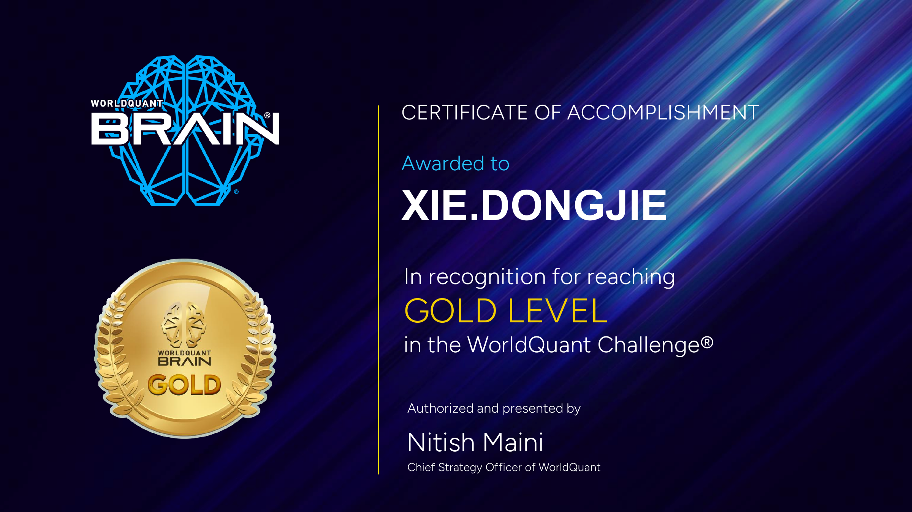
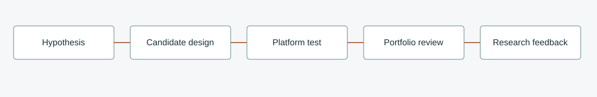
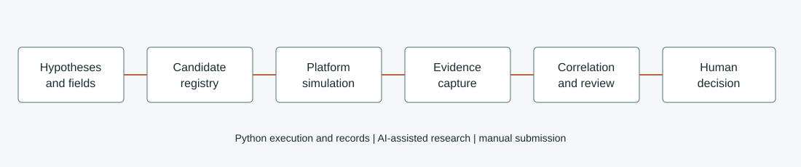

[View the original Gold certificate PDF](assets/gold_certificate.pdf) | [Certificate details](achievement/worldquant_gold.md)

# WorldQuant BRAIN Challenge Gold

**AI-assisted Quantitative Alpha Research System**

An evidence-led research project combining economic hypotheses, platform experiments and human-AI collaboration to discover and assess quantitative Alpha candidates.

## Why This Project Is Different

### Batch Alpha Discovery

Which financial ideas deserve a platform test? Candidates are organized around economic hypotheses and competing explanations, then screened for field availability, expression validity and duplicates. Batch results and failed experiments inform the next round, while controlled comparisons help distinguish a useful signal from a promising story.

### Portfolio-level Correlation Management

Can several individually promising candidates remain compatible as the submitted portfolio grows? Date-aligned daily PnL comparisons and official Self-Correlation checks support candidate review and conditional submission planning. The ACTIVE set and check time are recorded because each submission can change subsequent eligibility.

### Evidence-driven Human-AI Research Loop

What should be learned from each experiment? The human researcher frames the research and makes submission decisions. ChatGPT and Codex support analysis, implementation and review; Python records and analyzes evidence; WorldQuant BRAIN provides simulations and official checks. The loop turns results, including failures, into revised hypotheses and research priorities.

## Selected Research Cases

- **F024 / F035: Submission-eligibility observation.** F024 was rejected for high correlation after F035 was submitted. The available record does not identify the exact pair behind the reported maximum, so this observation does not establish a direct correlation between the two candidates.
- **F039 / F040 / F035: Testing price-volume explanations.** Does the combined signal capture trading-activity information beyond a price-related baseline? [Explore the mechanism identification case](research/selected_case_studies/03_mechanism_identification.md).
- **A038 / A054-V3: Dynamic Self-Correlation.** How does submitting one Alpha change another candidate's check? [Read the observed eligibility change](research/selected_case_studies/01_alpha_redundancy.md) and [the submission-order analysis](research/selected_case_studies/02_dynamic_correlation.md).

## How the System Works

| Role | Contribution |
|---|---|
| Human Researcher | Defines research priorities, evaluates evidence and makes submission decisions. |
| ChatGPT | Supports research synthesis, competing explanations and review of findings. |
| Codex | Assists with implementation, platform interaction, evidence collection and analysis. |
| Python & Research Skills | Organize candidate records, batch execution and analytical workflows, informed by the attributed research skills. |
| GitHub | Preserves versioned research records and supports collaboration. |
| WorldQuant BRAIN | Runs simulations and provides platform metrics and official checks. |

## Explore the Project

- [Getting Started](getting-started/README.md) - a first manual research cycle and reusable prompts.
- [Research Methodology](research/methodology.md) - hypotheses, controls and interpretation.
- [Discovery Pipeline](research/discovery_overview.md) - candidate discovery and experimental feedback; see also the [batch pipeline](engineering/batch_pipeline.md).
- [System Architecture](engineering/system_architecture.md) - research components and evidence flow.
- [Evidence & Metrics](docs/evidence_and_metrics.md) - sources, counts and their scope.
- [Limitations](docs/limitations.md) and [References](docs/references.md) - evidence boundaries and attribution.

## Evidence, Limitations & License

The [Gold certificate](assets/gold_certificate.pdf) verifies the recipient and Gold Level. Historical research records include 146 completed simulations in one group of waves: 107 discovery candidates, 33 field probes and 6 controls. A later local pool contained 140 candidate expressions, including 132 that passed local static checks; these counts do not establish platform success.

The platform IS results and examined 2019-2023 periods informed research decisions and do not establish verified out-of-sample profitability. Local candidate-to-candidate correlation is a planning proxy; future eligibility requires fresh official checks against the then-current ACTIVE set. Concrete expressions, platform Alpha IDs, account-linked PnL and credentials remain private. All F/A identifiers in this README are internal research labels, not WorldQuant platform Alpha IDs.

The workflow draws on [QuantML-Research/wq-alpha-research](https://github.com/QuantML-Research/wq-alpha-research), whose README declares CC BY-NC 4.0, and [dfkai/wq-challenge-gold-skill](https://github.com/dfkai/wq-challenge-gold-skill), licensed MIT. See [References](docs/references.md) for attribution. No license for this portfolio is asserted here.
