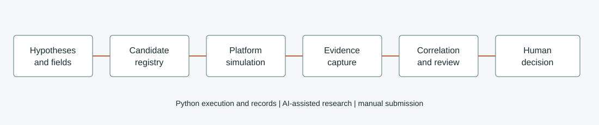

# System architecture

The system separates a candidate registry, platform execution, evidence capture and analysis. Each candidate carries a research hypothesis and complete intended settings. Completed simulations are read back to verify the actual expression and settings before their metrics enter analysis.

Official checks are stored as events with their observation time and the ACTIVE snapshot. Derived correlation matrices and candidate-order scenarios are linked back to the evidence used to construct them. The user reviews and submits Alphas manually.

Python handles data collection and analysis. AI supports research synthesis, code review and hypothesis development. The historical private research implementation remains separate from this portfolio.
